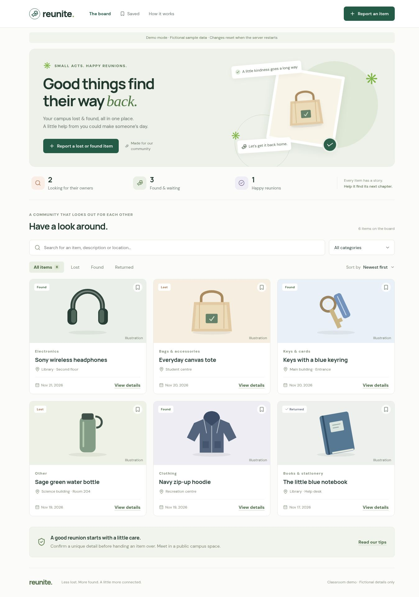
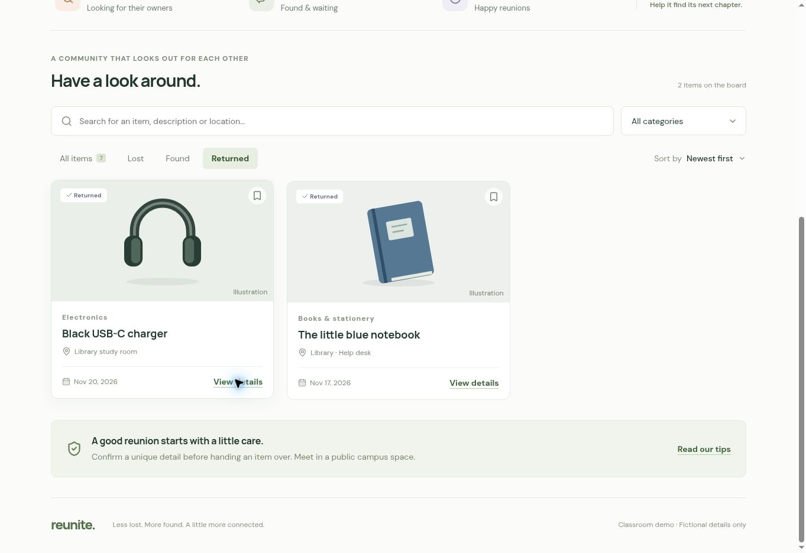
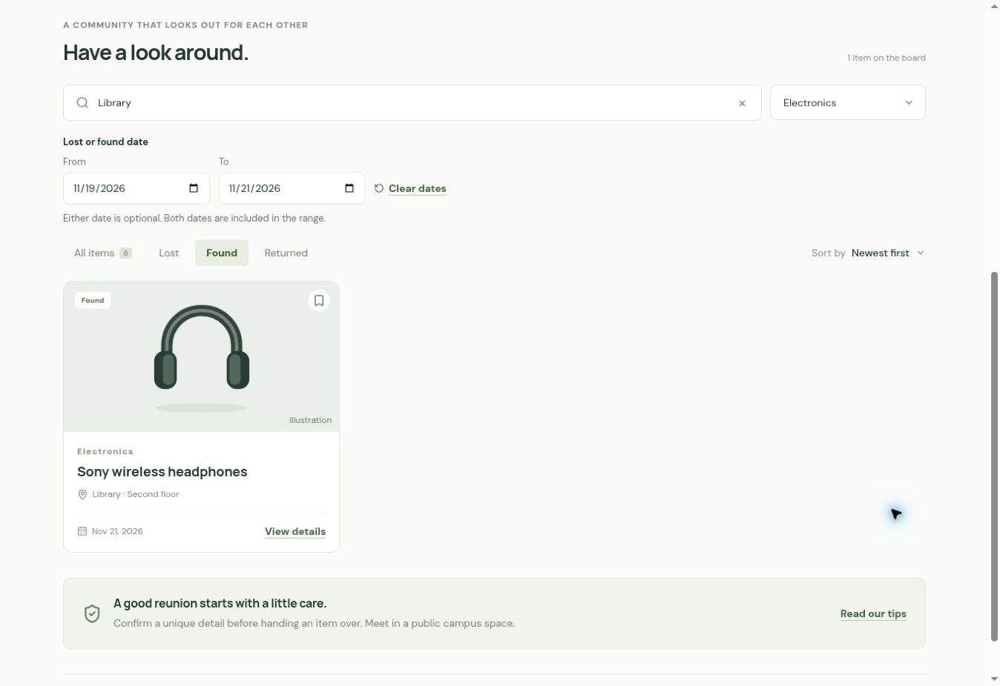
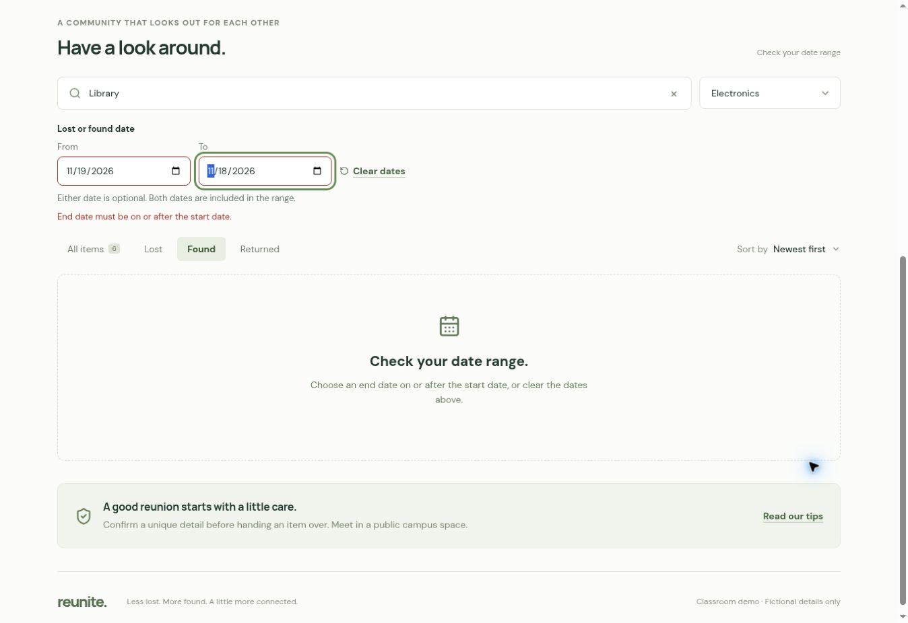

# Reunite

**A campus lost and found board built with MongoDB, Express, React and Node.js.**

Report a lost or found item, search the community board, save interesting posts, contact a reporter and mark an item returned after a handover.

## Description and intended users

Reunite brings campus lost-and-found notices into one searchable board for students, staff and campus help desks. Posts record an item's name, description, category, location, date and contact email. Category illustrations are decorative examples, not uploaded photographs of the reported items.

## Purpose

This project was chosen for the Introduction to AI Vibe Coding Challenge because it has a clear everyday purpose and several interactions that can be developed and tested in stages. The workflow is easy to demonstrate: **report → search → contact → return**.

## Features

- Report either a lost or found item with client and server validation.
- Search item names, descriptions and locations, ignoring case and surrounding spaces.
- Combine search, category, open lost/found/returned status and an inclusive date range.
- Filter by either or both dates the item was lost or found. Reversed ranges show a clear error.
- Clear dates independently, or reset all filters from the empty state.
- Sort by the date the item was lost or found, newest or oldest first.
- Open item details and a contact email link.
- Confirm before marking an item returned; board counts update immediately.
- Bookmark posts locally and view a Saved board. Bookmarks survive a browser refresh.
- Loading, empty, error and success states; keyboard focus styles and native modal dialogs.
- Responsive CSS for desktop, tablet and narrow screens.
- Six fictional sample posts and screenshots of the running application, including date filtering and validation.

## Technologies

- React and JavaScript with Vite for the frontend.
- CSS, Lucide icons and locally defined SVG category illustrations.
- Node.js and Express for the API.
- MongoDB and Mongoose for the persistent application.
- Node's test runner and Supertest for API and logic checks.
- Prettier for readable source formatting.
- `mongodb-memory-server-core` for optional tests with a temporary real MongoDB process.
- DM Sans and Manrope from Google Fonts; system fonts are used when offline.

Exact installed dependency versions are recorded in `package-lock.json`.

## AI tools used

ChatGPT with Codex coding tools was used for idea exploration, code generation, interface design, debugging, automated testing and documentation. The application does not call an AI model at runtime, so no AI API key or paid AI subscription is needed to run it.

## Installation

Install Node.js **22.12 or newer** and Git. Extract the project ZIP, or clone your published GitHub repository, then open a terminal in the folder containing `package.json`:

```bash
npm ci
```

`npm ci` installs the exact versions in the lockfile. It requires internet access on the first installation. Do not upload `node_modules` or `.env` to GitHub.

## Running the application

There are two separate data modes. They share the React interface, Express routes, validation and return workflow.

### Quick classroom demo — no MongoDB installation

```bash
npm run demo
```

Open **http://127.0.0.1:5173**. Leave the terminal running. Press **Ctrl+C** to stop.

This command deliberately uses a temporary in-process demo store. **It is not a MongoDB persistence test.** Posts and return statuses reset when the server restarts. A banner identifies demo mode. Bookmarks are stored separately in the browser and may remain after restart, but bookmarks for posts that no longer exist do not appear on the Saved board.

### Persistent MERN application — MongoDB required

1. Start a local MongoDB instance, or obtain a MongoDB Atlas connection URI.
2. Copy `.env.example` to `.env` in the project root. On Windows PowerShell:

   ```powershell
   Copy-Item .env.example .env
   ```

   On macOS/Linux:

   ```bash
   cp .env.example .env
   ```

3. Set `MONGODB_URI` in `.env`. The example uses a local, non-authenticated development database:

   ```text
   MONGODB_URI=mongodb://127.0.0.1:27017/reunite
   PORT=5000
   ```

   Keep real connection credentials out of Git. Atlas setup and network access are configured in your own account; no Atlas account is bundled with the project.

4. Optionally add the six fictional examples to an empty database:

   ```bash
   npm run seed
   ```

   Seeding does not overwrite a database that already contains items.

5. Start the API and frontend:

   ```bash
   npm run dev
   ```

   Open **http://127.0.0.1:5173**. The normal API uses port **5000**. In this mode, items and return statuses persist in MongoDB.

`DATA_MODE=demo` in an optional local `.env` makes `npm run dev` use demo mode. Omit that setting for the normal MERN database connection.

### Production build on your own computer

With MongoDB configured:

```bash
npm run build
npm start
```

Open **http://127.0.0.1:5000**. Express serves the built React files. This is a local run command, not a public deployment service.

### Optional temporary real MongoDB demo

```bash
npm run demo:mongo
```

This downloads MongoDB 7.0.24 on its first run, starts a temporary real database and seeds it. It requires a compatible operating system and permission to run MongoDB. Records reset after stopping. Use your own MongoDB installation or Atlas if the binary cannot start.

## How the application is organised

```text
client/
  src/App.jsx                  Board state, navigation and user actions
  src/components/ReportForm.jsx  Item form and field errors
  src/components/ItemCard.jsx    Listing card and date formatting
  src/components/Modal.jsx       Native accessible dialog wrapper
  src/components/ItemArt.jsx     Category illustrations
  src/api.js                    API request helper
  src/style.css                 Layout and responsive design
server/
  app.js                        HTTP routes and error handling
  index.js                      MongoDB connection and server startup
  item.js                       Mongoose schema
  repositories.js               MongoDB adapter and explicit demo store
  validation.js                 Input validation and field allowlist
  sample-data.js                Fictional sample records
shared/
  constants.js                  Valid categories and item types
  board.js                      Search, filters, sorting and counts
scripts/                        Development, demo and seed commands
tests/                          Automated checks and optional MongoDB integration
docs/                           Screenshots, prompts, test notes and development log
```

The browser calls `/api/items` through the Vite development proxy. Express validates the request and calls a repository. The normal repository uses Mongoose to read/write MongoDB. React renders the returned JSON and updates the board. Bookmarks are intentionally local to the browser rather than shared database records.

## API endpoints

| Method | Endpoint                | Purpose                                     |
| ------ | ----------------------- | ------------------------------------------- |
| GET    | `/api/health`           | Show API and data-mode status               |
| GET    | `/api/items`            | List posts, including returned posts        |
| POST   | `/api/items`            | Validate and create an open post            |
| PATCH  | `/api/items/:id/status` | Change a valid post to `open` or `returned` |

The interface exposes the returned transition. The API also accepts `open` to support reopening during future development. Filtering currently happens in the browser; pagination is a future improvement.

## How AI was used

AI helped turn an application choice into React components, an Express API, a Mongoose schema and testable helper functions. It also helped diagnose failed startup assumptions and separate a runnable demo from real database verification.

Three examples from my planning, troubleshooting and refinement conversation were:

1. **“or MERN application?”** — established MongoDB, Express, React, and Node.js as the technology stack.
2. **Shared the `npm ci` error: “can only install with an existing package-lock.json”** — helped identify that I was running the command in the outer folder. Switching into `reunite` allowed installation to succeed.
3. **“Add a date range filter to Reunite. It should work together with search, category, and status filters. Validate that the end date is not before the start date, and test the filtering behavior.”** — led to inclusive From/To controls, combined filtering, a reversed-range error, reset controls and 10 new automated tests. The resulting suite passes all 26 tests, and the browser behavior was checked separately.

These examples show how broad planning became troubleshooting using actual terminal output, followed by a specific feature request with validation and testing requirements. Further details are recorded in [the development log](docs/development-log.md) and [the prompt notes](docs/prompts.md).

## Screenshots

These are actual browser screenshots from temporary demo mode, not mockups.

### Working board with fictional sample posts



### Newly created test item after its status was changed to returned



The charger uses the Electronics category illustration. Illustrations are not item photographs.

### Combined search, category, status and date filters



### Reversed range validation



## Using the date range filter

Under **Lost or found date**, enter **From**, **To**, or both. The dates refer to when an item was lost or found, not when its post was created. Both boundaries are inclusive, and the same date in both fields searches one day. Dates combine with search, category, status, saved items and sort order.

An end date before the start date displays **“End date must be on or after the start date.”** and hides results until the dates are corrected or cleared. **Clear dates** retains the other filters. **Clear filters** in a no-match state resets the search, category, status and dates.

## Testing

```bash
npm test
npm run build
```

The standard suite contains **26 passing tests**, covering API creation/listing/status changes, invalid input, malicious extra fields, malformed JSON, body limits, missing IDs, filters, counts, sorting, inclusive and one-sided date ranges, same-day ranges, reversed-range validation, combined date/search/category/status/bookmark filtering, and Mongoose schema validation without a live database.

**The standard API tests use the explicit demo repository.** A separate test exercises the real MongoDB path:

```bash
npm run test:mongo
```

In the coding workspace, MongoDB 8 failed during CPU detection and MongoDB 7 failed with `open: Operation not permitted`. The integration test is retained for a compatible machine, but **it has not passed here**. A passing build or schema check does not prove live MongoDB persistence. Verify your own MongoDB/Atlas connection and rerun the integration test before claiming the full MERN path is tested.

On Windows, the MongoDB application ran successfully, all 16 standard tests passed, and the production build succeeded. A newly created post remained saved after restarting the application, confirming manual database persistence. The separate automated MongoDB integration test has not been run on Windows.

After the date-filter iteration, `npm test` passed all 26 tests and `npm run build` passed in the coding workspace. Browser checks confirmed inclusive boundaries, combined search/category/Found filters, a reversed-range error, clearing dates while retaining other filters, and clearing all filters from a no-match state. A fresh clone of the published GitHub repository had also passed installation, the original 16 tests, a build and demo startup before this iteration. See [test notes](docs/testing.md) for the scope of each check.

Earlier browser checks confirmed: loading six sample records, no-match search, bookmarking, bookmarks after refresh, category filtering, rejecting whitespace-only titles, posting a valid fictional item, contact details, and the returned confirmation/count updates. See [test notes](docs/testing.md) for results and remaining checks.

## Vibe Coding Reflection

This reflection describes the AI-assisted development and my local testing of Reunite.

### 1. What did AI do particularly well?

AI quickly connected the user workflow to React components, Express routes and a shared item structure. It generated consistent forms, listing cards and sample data, leaving more time to consider how returning an item should change counts and filters.

### 2. What did AI do poorly?

The initial setup assumed a MongoDB binary would run in the coding environment. It did not. The first preview wrapper also failed to forward the preview tool's requested port to Vite. Those assumptions stopped startup despite a successful frontend build. Separating the demo store, keeping the real MongoDB path, and forwarding arguments corrected the runnable preview without pretending database integration had passed.

### 3. How did you verify AI-generated code?

I ran all 16 automated tests and successfully built the application on Windows. I also created a new post, restarted the application, and confirmed that the post remained saved in MongoDB. The automated API tests use a temporary demo store, while my restart check separately verified real database persistence. After adding the date range filter, the coding assistant ran the expanded 26-test suite, built the application, and checked valid, invalid, combined and reset states in the browser. This new feature still needs my own Windows review after I pull the update.

### 4. How did your prompts evolve?

My early prompts were broad, such as “more ideas” and “or MERN application?” Later, I shared the exact `npm ci` error and terminal output so troubleshooting could target the folder and command I was using. My date-filter prompt was more specific: it requested a feature, required it to combine with existing filters, identified an invalid range, and explicitly asked for tests. That produced a concrete improvement with observable success and error states instead of a general request to “make it better”.

### 5. What did you learn?

A frontend build, an API test double and a real database test prove different things. Dependency injection allows the interface and HTTP behaviour to be tested separately, but passing those checks must not be described as proof of MongoDB persistence. Keeping these distinctions in the documentation is part of taking responsibility for generated code.

### 6. Would you trust AI to build the entire application without human supervision?

No. AI can produce convincing code while making incorrect environment assumptions or leaving ownership and privacy controls out of scope. A person must review the behaviour, verify the real database setup, decide what data is appropriate and understand the main components before demonstrating or sharing the application.

## Future improvements

1. Add authenticated accounts and ownership checks so only a reporter or moderator can change a post.
2. Add moderated photo uploads with size/type checks rather than category illustrations.
3. Add private messaging so contact email addresses do not need to be exposed.
4. Add database-side search, pagination and filters for larger collections.
5. Add an optional matching suggestion feature with an explanation of why two posts may match.

## Current scope and privacy

This is a classroom prototype, not a public production service. There is no authentication, ownership enforcement, moderation or email verification. Anyone who can reach the API can post or change a status, and contact email addresses are included in API responses. Use fictional information and keep the prototype local. The tips in the interface advise confirming a unique detail and meeting in a public place; the application does not verify identity or ownership.

## Publishing and submission

Submit an accessible **GitHub repository URL**. The README, source and screenshots belong in that repository. Public internet deployment is not required by the assignment.

The ZIP contains its real `.git` history. Use [the setup guide](GETTING_STARTED.md) to preserve the commits when publishing. Commits were made during one AI-assisted session; they are not evidence of work spread across different days. The application was published to GitHub and manually checked with local MongoDB on Windows. Later feature checks performed by the coding assistant are distinguished from the student’s Windows checks in the test notes.

## Documentation sources

- [React documentation](https://react.dev/learn)
- [Vite guide](https://vite.dev/guide/)
- [Express error handling](https://expressjs.com/en/guide/error-handling/)
- [Mongoose validation](https://mongoosejs.com/docs/validation.html)
